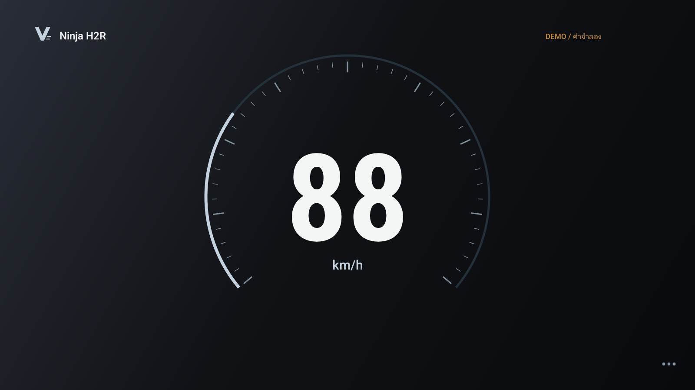

# Velocity Moto

An offline Android GPS speedometer with motorcycle-inspired dashboards and synthesized engine sounds that respond to speed. Built with native Java.

[Download APK](https://github.com/khunkish/velocity-moto/releases/latest) · [คู่มือภาษาไทย](docs/USER_GUIDE.th.md)



## Features

- Swipe between 15 dial positions, including 12 motorcycle-inspired styles.
- 24 themes with soft light, dark, pearl, and glossy finishes.
- 8 engine characters and 12 exhaust profiles, with adjustable bass.
- Optional virtual gear shifts, RPM drops, and subtle ignition effects.
- Trip history, manual lap timing, and GPX/CSV export.

GPS speed is real; engine audio, RPM, and gears are simulated. No ECU/OBD connection. Tracking pauses when the app leaves the foreground.

## Get started

Install the APK on **Android 8.0+**, allow precise location, then tap the dial and select **Start GPS**. Swipe left/right to change dials; tap to open settings. The current app interface is mainly Thai.

Release APKs are debug builds for testing.

## Build

Requires **Java 17 or 21** and **Android SDK 34**. Configure `ANDROID_HOME` or `local.properties`, then run:

```bash
./gradlew assembleDebug lintDebug
```

Windows: `gradlew.bat assembleDebug lintDebug`

Output: `app/build/outputs/apk/debug/app-debug.apk`

[More screenshots](docs/screenshots) · [Verification notes](VERIFICATION.md)

## Credits

**@khunkish — One Second Hub Co., Ltd.**

[GitHub](https://github.com/khunkish) · [Instagram](https://www.instagram.com/khunkish) · [YouTube](https://www.youtube.com/@khunkish)
